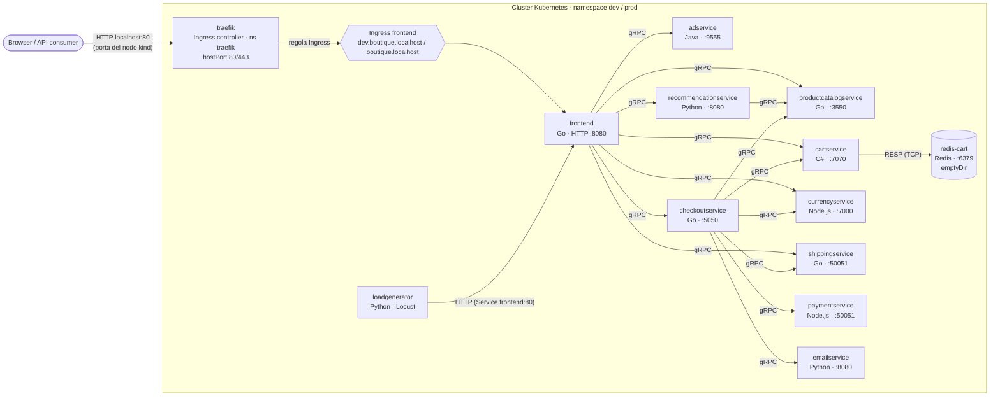

# Architettura — Online Boutique per la challenge Kiratech L2

Versione analizzata: **v0.10.7** (chart `helm-chart/` 0.10.7, immagini `…/microservices-demo/*:v0.10.7`).
Fonte dei dati: manifest generati dal chart e oggetti reali nel cluster kind (`kubectl get deploy,svc -n dev`),
più il codice in `src/` e `protos/demo.proto`. Dove il README upstream e il codice non coincidono, vale il codice.
Etichette: **VERIFICATO** (comando o codice), **IPOTESI** (plausibile, non misurato).

> Il progetto è svolto per fasi: F1 analisi e primo deploy · F2 packaging dev/prod e sicurezza · F3 CI/CD e GitOps ·
> F4 osservabilità · F5 troubleshooting e rollback · F6 Krateo · F7 documentazione e demo.
> Le scelte e la loro motivazione sono in [`DECISIONS.md`](DECISIONS.md).

## 1. Vista d'insieme

**Dominio:** e-commerce dimostrativo. L'utente sfoglia un catalogo, converte i prezzi in un'altra valuta, mette articoli
nel carrello e completa un ordine con pagamento, spedizione ed email simulati. Non c'è login: la sessione è un cookie.

**In una frase:** un unico punto d'ingresso HTTP (frontend) che chiama direttamente 7 servizi backend via gRPC.
`checkoutservice` orchestra il flusso d'acquisto e raggiunge anche payment ed email (9 backend in totale).
L'unico stato è il carrello in Redis.

**Quanti servizi:** l'upstream parla di 11 microservizi, cioè 10 applicativi + loadgenerator. A questi si aggiunge Redis:
nel cluster ci sono 12 Deployment (VERIFICATO). `shoppingassistantservice` (12ª cartella in `src/`, assistente basato su
Gemini/AlloyDB) è disattivato di default nel chart e **non è usato**.

## 2. Servizi

Porte: *container* = `containerPort`, *Service* = porta del Service Kubernetes (VERIFICATO con `kubectl get svc -n dev`).

| Servizio | Linguaggio (build) | Container → Service | Protocollo | Chiama (variabili `*_ADDR`) | Ruolo |
|---|---|---|---|---|---|
| frontend | Go (`go.mod`) | 8080 → 80 | HTTP (HTML + un endpoint JSON) | productcatalog, currency, cart, recommendation, shipping, checkout, ad (+ shoppingassistant, non installato) | Sito web; session ID via cookie, nessun login |
| checkoutservice | Go | 5050 → 5050 | gRPC | productcatalog, shipping, payment, email, currency, cart | Orchestra l'ordine: carrello → prezzi → pagamento → spedizione → email |
| productcatalogservice | Go | 3550 → 3550 | gRPC | — | Catalogo letto da `products.json` nell'immagine |
| shippingservice | Go | 50051 → 50051 | gRPC | — | Preventivo e spedizione simulati |
| cartservice | C# (.NET, `cartservice.csproj`) | 7070 → 7070 | gRPC | Redis (`REDIS_ADDR=redis-cart:6379`) | Carrello per sessione |
| currencyservice | Node.js | 7000 → 7000 | gRPC | — | Conversione valute da `data/currency_conversion.json` (statico: il README upstream parla di valori "real" della BCE, ma il codice legge il file locale, `server.js:110`) |
| paymentservice | Node.js | 50051 → 50051 | gRPC | — | Addebito simulato; rifiuta alcuni tipi di carta (vedi §3) |
| emailservice | Python | 8080 → **5000** | gRPC | — | Email di conferma simulata (`DummyEmailService`) |
| recommendationservice | Python | 8080 → 8080 | gRPC | productcatalog | Suggerisce prodotti non presenti nel carrello |
| adservice | Java (Gradle) | 9555 → 9555 | gRPC | — | Annunci testuali in base al contesto |
| redis-cart | Redis (`redis:alpine@sha256:8096…`) | 6379 → 6379 | RESP su TCP | — | Unico componente stateful; volume `emptyDir` |
| loadgenerator | Python / Locust | — (nessun Service) | client HTTP | `FRONTEND_ADDR=frontend:80`, `USERS=10`, `RATE=1` | Traffico sintetico; l'init container `frontend-check` attende il frontend |

Contratti gRPC: `protos/demo.proto` (9 servizi: Cart, Recommendation, ProductCatalog, Shipping, Currency, Payment,
Email, Checkout, Ad). Non c'è service discovery esterno: i servizi si trovano tramite il DNS dei Service Kubernetes.

## 3. Flussi principali (VERIFICATI su `frontend/handlers.go` e `checkoutservice/main.go`)

**Home page** (`GET /`): frontend → currency (`GetSupportedCurrencies`) → productcatalog (`ListProducts`) →
cart (`GetCart`) → currency (`Convert`, una chiamata per prodotto) → ad (`GetAds`). Per questo currencyservice
dovrebbe essere il servizio con più richieste al secondo (IPOTESI dal codice: da misurare con le metriche).

**Acquisto** (`POST /cart/checkout`): frontend → checkout `PlaceOrder` → cart `GetCart` → productcatalog `GetProduct`
(per articolo) → currency `Convert` → shipping `GetQuote` → payment `Charge` → shipping `ShipOrder` →
cart `EmptyCart` → email `SendOrderConfirmation`. Se il pagamento fallisce, l'ordine fallisce e nulla viene spedito.

**Errore di fondo atteso (VERIFICATO):** con il solo loadgenerator circa l'1,5% dei checkout fallisce
(log Locust: `POST /cart/checkout 476 richieste, 7 fail (1.47%)`). paymentservice rifiuta alcuni tipi di carta generati
a caso (`Sorry, we cannot process visa_electron credit cards`). È un comportamento voluto dall'upstream, non un guasto:
va tenuto presente nelle soglie di allarme e non va confuso con i guasti simulati nella demo.

**Endpoint JSON:** `GET /product-meta/{ids}` (`src/frontend/main.go:162`) restituisce i metadati dei prodotti in JSON.
È l'unica risposta non-HTML del frontend ed è minimale: in caso di errore risponde comunque 200 con corpo vuoto.

## 4. Ingressi, storage, configurazione, sicurezza (VERIFICATO nel cluster)

Prima colonna: chart upstream (F1). Seconda: stato dopo il packaging dev/prod (F2). Dettagli e verifiche in [`SECURITY.md`](SECURITY.md).

| Aspetto | Upstream | Oggi (dev e prod) |
|---|---|---|
| Ingresso esterno | Service `frontend-external` `LoadBalancer`, `<pending>` su kind | **Ingress** servito da Traefik; porte 80/443 del nodo kind pubblicate su `127.0.0.1`; il LoadBalancer è disattivato |
| Storage | Redis su `emptyDir`: i carrelli si perdono se il pod viene ricreato | Invariato: accettato per una demo, limite dichiarato |
| Configurazione | Solo variabili d'ambiente nei Deployment | **ConfigMap** `frontend-config` (piattaforma, branding, sessione) + `deploy/values-common.yaml` e `values-<env>.yaml` |
| Secret | Nessuno; Redis senza password | Password di Redis in un **Secret** generato da un `SealedSecret` cifrato in Git, diverso per ambiente |
| Identità | Un ServiceAccount per servizio, token montato | Token **non** montato (`automountServiceAccountToken: false`) |
| RBAC | Nessun Role/RoleBinding | App: nessun permesso (verificato con `kubectl auth can-i`); Role `ops-readonly` per gli operatori L2 |
| securityContext | `runAsNonRoot`, utente 1000, `readOnlyRootFilesystem`, `drop: ALL` | In più seccomp `RuntimeDefault` |
| NetworkPolicy | Nel chart ma disattivate | **Attive**: deny-all + una regola per servizio; kindnet le applica (test di blocco con pod esterno) |
| Probe | gRPC sui backend, HTTP `/_healthz` sul frontend, TCP su Redis | Invariate (approfondimento nella fase di osservabilità) |
| Spegnimento | Nessun hook | Frontend con `preStop` di 5 s: rolling update di prod senza errori (0 su 399 richieste, prima 3 su 417) |
| Log | JSON su stdout quasi ovunque; testo su cartservice, Redis, loadgenerator | Invariato (gap su cartservice, fase di osservabilità) |
| Immagini | Tag `v0.10.7`; Redis e busybox per digest | Frontend costruito da noi con base per digest; gli altri per tag (limite L5 in `SECURITY.md`) |

## 5. Mappatura dei componenti richiesti dalla challenge (PDF §3)

| Componente richiesto | Implementazione | Gap / azione |
|---|---|---|
| Client / API consumer | Browser e `loadgenerator` (Locust); `curl` su `/product-meta/{ids}` | — |
| Ingress o Route | Ingress `frontend` con Traefik (controller), un host per ambiente | Coperto. Gateway API come evoluzione possibile |
| API Service (REST) | `frontend` espone HTTP (HTML) e un solo endpoint JSON minimale; il contratto vero tra servizi è gRPC (`demo.proto`) | **Gap parziale**, dichiarato |
| Worker / componente asincrono | Nessuno: tutte le chiamate sono sincrone | **Gap**: un CronJob di smoke test come componente batch |
| Database, cache, broker | Redis (stato del carrello); nessun broker | Broker assente, dichiarato |
| ConfigMap e Secret | ConfigMap del frontend; Secret `redis-auth` da Sealed Secrets | Coperto (`SECURITY.md`) |
| CI/CD o GitOps | Workflow upstream legati a Google Cloud (disattivati sul fork) | GitHub Actions + Argo CD (F3) |
| Monitoring e logging | Log JSON quasi ovunque; integrazioni Google Cloud Operations disattivate; nessun `/metrics` Prometheus | Metrica nel frontend, Prometheus e Grafana (F4) |
| Krateo | — | Blueprint e YAML concettuale, PoC se le risorse lo permettono (F6) |

## 6. Struttura del repository e build

| Percorso | Contenuto | Usato? |
|---|---|---|
| `src/<servizio>/` | Codice e `Dockerfile` di ogni servizio (multi-stage, `FROM --platform=$BUILDPLATFORM`) | Sì (build del solo frontend) |
| `protos/` | Definizioni gRPC condivise | Come riferimento |
| `helm-chart/` | Chart Helm | **Sì**, unico strumento di deploy |
| `kubernetes-manifests/`, `kustomize/`, `release/` | Alternative di deploy upstream | No |
| `istio-manifests/`, `terraform/`, `cloudbuild.yaml`, `skaffold.yaml` | Integrazioni Google Cloud / Istio | No |
| `kind/cluster.yaml`, `scripts/` | **Aggiunti per la challenge** (vedi `CHANGES.md`) | Sì |

Build: ogni servizio ha il proprio Dockerfile; i linguaggi sono 5 (Go, C#, Node.js, Python, Java).
Si ricompila solo il frontend; gli altri servizi usano le immagini upstream `v0.10.7`.

## 7. Punti di estensione e leve di configurazione
- **Values del chart**: `create` per servizio, risorse, `networkPolicies`, `seccompProfile`, `images.repository/tag`.
- **Variabili d'ambiente (VERIFICATE nel codice)**:
  - frontend: `ENV_PLATFORM`, `BANNER_COLOR`, `FRONTEND_MESSAGE`, `CYMBAL_BRANDING`, `ENABLE_ASSISTANT`, `BASE_URL`, `ENABLE_SINGLE_SHARED_SESSION`;
  - productcatalogservice: `EXTRA_LATENCY`, utile per simulare un servizio lento;
  - loadgenerator: `USERS`, `RATE`.
- **Componenti Kustomize upstream** (`kustomize/components/`): network-policies, without-loadgenerator, ecc. Non usati: uno strumento solo.
- **Nuovi servizi**: guida upstream `docs/adding-new-microservice.md`; contratto via `demo.proto`.
- **Osservabilità**: il frontend è il punto naturale per una metrica HTTP, perché tutto il traffico esterno passa da lì.

## 8. Risorse (misurate)
Somma delle `requests` di memoria dei 12 pod ≈ 1,6 GB (limits ≈ 3 GB). Consumo reale misurato a regime
con il loadgenerator attivo: nodo kind **1,19-1,25 GiB** (`docker stats`, 12/11/2026).
Nota: l'init container `frontend-check` del loadgenerator non dichiara risorse; se si introducono ResourceQuota o LimitRange va gestito.
