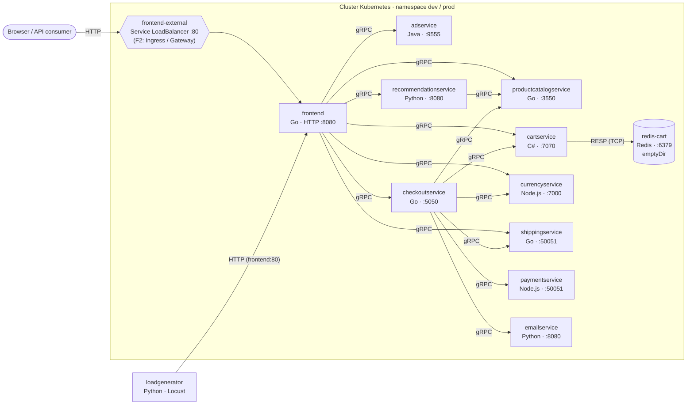

# Architettura — Online Boutique per la challenge Kiratech L2

Versione analizzata: **v0.10.7** (chart `helm-chart/` 0.10.7, immagini `…/microservices-demo/*:v0.10.7`).
Fonte dei dati: manifest generati dal chart e oggetti reali nel cluster kind (`kubectl get deploy,svc -n dev`),
più il codice in `src/` e `protos/demo.proto`. Dove il README upstream e il codice non coincidono, vale il codice.

## 1. Vista d'insieme

**In una frase:** un unico punto d'ingresso HTTP (frontend) che orchestra 9 servizi backend via gRPC;
`checkoutservice` è il secondo orchestratore (il flusso d'acquisto); l'unico stato è il carrello in Redis.

## 2. Servizi

Porte: *container* = `containerPort`, *Service* = porta del Service Kubernetes (verificate con `kubectl get svc -n dev`).

| Servizio | Linguaggio (build) | Container → Service | Protocollo | Chiama (variabili `*_ADDR`) | Ruolo |
|---|---|---|---|---|---|
| frontend | Go (`go.mod`) | 8080 → 80 | HTTP (HTML) | productcatalog, currency, cart, recommendation, shipping, checkout, ad (+ shoppingassistant, non installato) | Sito web; crea un session ID via cookie, nessun login |
| checkoutservice | Go | 5050 → 5050 | gRPC | productcatalog, shipping, payment, email, currency, cart | Orchestra l'ordine: carrello → prezzi → pagamento → spedizione → email |
| productcatalogservice | Go | 3550 → 3550 | gRPC | — | Catalogo letto da `products.json` nell'immagine |
| shippingservice | Go | 50051 → 50051 | gRPC | — | Preventivo e spedizione simulati |
| cartservice | C# (.NET, `cartservice.csproj`) | 7070 → 7070 | gRPC | Redis (`REDIS_ADDR=redis-cart:6379`) | Carrello per sessione |
| currencyservice | Node.js | 7000 → 7000 | gRPC | — | Conversione valute da `data/currency_conversion.json` (statico: il README upstream parla di valori "real" della BCE, ma il codice legge il file locale, `server.js:110`) |
| paymentservice | Node.js | 50051 → 50051 | gRPC | — | Addebito simulato su carta, restituisce un transaction ID |
| emailservice | Python | 8080 → **5000** | gRPC | — | Email di conferma simulata (`DummyEmailService`) |
| recommendationservice | Python | 8080 → 8080 | gRPC | productcatalog | Suggerisce prodotti non presenti nel carrello |
| adservice | Java (Gradle) | 9555 → 9555 | gRPC | — | Annunci testuali in base al contesto |
| redis-cart | Redis (`redis:alpine@sha256:8096…`) | 6379 → 6379 | RESP su TCP | — | Unico componente stateful; volume `emptyDir` |
| loadgenerator | Python / Locust | — (nessun Service) | HTTP client | `FRONTEND_ADDR=frontend:80`, `USERS=10`, `RATE=1` | Traffico sintetico; init container `frontend-check` attende il frontend |

Contratti gRPC: `protos/demo.proto` (9 servizi: Cart, Recommendation, ProductCatalog, Shipping, Currency, Payment,
Email, Checkout, Ad). Non c'è service discovery esterno: i servizi si trovano con il DNS dei Service Kubernetes.

## 3. Flussi principali

**Home page** (`GET /`): frontend → currency (`GetSupportedCurrencies`) → productcatalog (`ListProducts`) →
cart (`GetCart`) → currency (`Convert`, una chiamata per prodotto) → ad (`GetAds`). È il motivo per cui
currencyservice è il servizio con più richieste al secondo.

**Acquisto** (`POST /cart/checkout`): frontend → checkout `PlaceOrder` → cart `GetCart` → productcatalog `GetProduct`
(per articolo) → currency `Convert` → shipping `GetQuote` → payment `Charge` → shipping `ShipOrder` →
cart `EmptyCart` → email `SendOrderConfirmation`. Se il pagamento fallisce, l'ordine fallisce e nulla viene spedito.

## 4. Ingressi, storage, configurazione, sicurezza (stato upstream, VERIFICATO nel cluster)

| Aspetto | Com'è oggi | Nota per le fasi successive |
|---|---|---|
| Ingresso esterno | Service `frontend-external` di tipo `LoadBalancer`; su kind resta `<pending>` | Nessun Ingress nel chart → da aggiungere in F2 (R-06) |
| Storage | Redis su `emptyDir`: i carrelli si perdono se il pod viene ricreato | Accettabile per una demo; limite da dichiarare |
| Configurazione | Solo variabili d'ambiente nei Deployment; **nessuna ConfigMap applicativa** | Da introdurre in F2 per differenziare dev/prod |
| Secret | **Nessun Secret applicativo**; Redis senza password | D-07 (Sealed Secrets) |
| Identità | Un ServiceAccount per servizio; `automountServiceAccountToken` non impostato (quindi token montato) | F2: disattivare il montaggio, nessun Role necessario |
| RBAC | Nessun Role/RoleBinding: i servizi non usano l'API Kubernetes | Privilegio minimo già rispettato; da dimostrare con `kubectl auth can-i` |
| securityContext | `runAsNonRoot`, utente 1000, `readOnlyRootFilesystem`, `drop: ALL`, no privilege escalation | Già buono; `seccompProfile` disattivato di default |
| NetworkPolicy | Presenti nel chart ma disattivate (`networkPolicies.create: false`) | F2: attivarle (kind usa kindnet: DA VERIFICARE il supporto) |
| Probe | gRPC health check su tutti i backend, HTTP `/_healthz` sul frontend, TCP su Redis; nessuna sul loadgenerator | R-12 in gran parte già soddisfatto dall'upstream |

## 5. Mappatura dei componenti richiesti dalla challenge (PDF §3)

| Componente richiesto | Implementazione | Gap / azione |
|---|---|---|
| Client / API consumer | Browser e `loadgenerator` (Locust) | — |
| Ingress o Route | Oggi Service LoadBalancer non funzionante su kind | **Gap**: Ingress o Gateway API in F2 (scelta da motivare in D-13) |
| API Service (REST) | `frontend` espone HTTP, ma restituisce HTML, non un'API REST JSON | **Gap parziale**: dichiarato; il contratto "API" vero è gRPC (`demo.proto`) |
| Worker / componente asincrono | Nessuno: tutte le chiamate sono sincrone | **Gap**: D-10, CronJob di smoke test come componente batch |
| Database, cache, broker | Redis (cache/stato del carrello); nessun broker | Broker assente, dichiarato |
| ConfigMap e Secret | Assenti (solo env) | **Gap**: F2 (R-06, R-14) |
| CI/CD o GitOps | Workflow upstream legati a GCP | F3: GitHub Actions + Argo CD (D-08) |
| Monitoring e logging | Log su stdout: JSON per frontend, checkout, currency, email; testo semplice per cartservice (`kubectl logs`, 12/11). Integrazioni Google Cloud Operations disattivate, nessun `/metrics` Prometheus | F4: log JSON, metrica nel frontend (D-06), Prometheus/Grafana |
| Krateo | — | F6: blueprint e YAML concettuale (D-09) |

## 6. Struttura del repository e build

| Percorso | Contenuto |
|---|---|
| `src/<servizio>/` | Codice e `Dockerfile` di ogni servizio (multi-stage, `FROM --platform=$BUILDPLATFORM`) |
| `protos/` | Definizioni gRPC condivise |
| `helm-chart/` | Chart Helm usato in questo progetto (D-03) |
| `kubernetes-manifests/`, `kustomize/`, `release/` | Alternative di deploy upstream (non usate) |
| `istio-manifests/`, `terraform/`, `cloudbuild.yaml`, `skaffold.yaml` | Integrazioni GCP/Istio upstream (non usate) |
| `kind/cluster.yaml`, `scripts/` | **Aggiunti per la challenge** (vedi `docs/CHANGES.md`) |

Build: ogni servizio ha il proprio Dockerfile; i linguaggi sono 5 (Go, C#, Node.js, Python, Java).
Per D-05 si ricompila solo il frontend (F2); gli altri usano le immagini upstream `v0.10.7`.

## 7. Punti di estensione
- **Values del chart**: `create` per servizio, risorse, `networkPolicies`, `seccompProfile`, `images.repository/tag`.
- **Componenti Kustomize upstream** (`kustomize/components/`): network-policies, without-loadgenerator, ecc. (non usati: uno strumento solo).
- **Nuovi servizi**: guida upstream `docs/adding-new-microservice.md`; contratto via `demo.proto`.
- **Osservabilità**: il frontend è il punto naturale per una metrica HTTP (tutto il traffico passa da lì).

## 8. Risorse (misurate)
Somma delle `requests` di memoria dei 12 pod ≈ 1,6 GB (limits ≈ 3 GB). Consumo reale misurato a regime
con il loadgenerator attivo: nodo kind **1,19 GiB** (`docker stats`, 12/11/2026).
