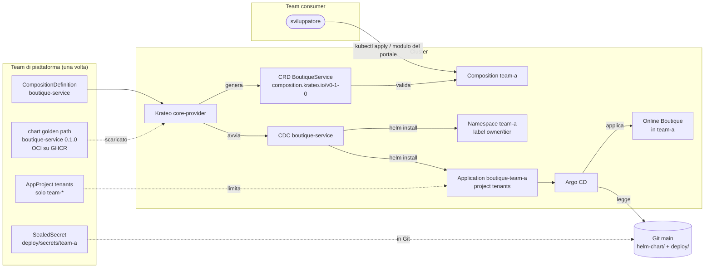

# Krateo: valutazione tecnica e PoC minima

Ambito: PDF della challenge §2.5 e §5 (requisito R-20). Krateo è trattato come **punto aperto**: questa è una valutazione con un disegno
di integrazione, YAML reali e una PoC limitata al motore di Krateo.
Fonti consultate il 18/11/2026 (elenco in fondo). Etichette: **VERIFICATO** (documentazione, codice o comando), **IPOTESI** (non provato).


## 1. In sintesi

- **Raccomandazione: adozione graduale.** Subito il solo motore di Krateo (core-provider) come **API self-service sopra Argo CD**.
  Il portale completo arriva in un secondo momento, quando ci sono più team consumer e un cluster di piattaforma dimensionato.
- **Perché non tutto subito.** Krateo PlatformOps 3.0.0 completo chiede 12 vCPU e 16 GiB (VERIFICATO, docs.krateo.io), cioè più dell'intera
  macchina della demo. Con un solo team, inoltre, un portale costa più di quanto rende.
- **Perché sì al motore.** Trasforma "installa Online Boutique con questi values" in un tipo Kubernetes nuovo (`BoutiqueService`) con pochi campi
  validati. Le regole di piattaforma (sicurezza, NetworkPolicy, immagini fissate, GitOps) restano nel template e il team consumer non le può toccare.
- **Krateo non sostituisce Helm né Argo CD: si mette davanti a loro.** È anche il modello del blueprint ufficiale `github-scaffolding-lifecycle`,
  che rende un'Application di Argo CD (VERIFICATO, `blueprint/templates/argo-application.yaml`).


## 2. Krateo in breve (VERIFICATO sulla documentazione 3.0.0)

```
Componente;Cosa fa;Usato nella PoC
core-provider 1.0.0;osserva le CompositionDefinition, genera una CRD dal values.schema.json del chart e avvia un controller dedicato (CDC);sì
composition-dynamic-controller (CDC) 1.0.0;per ogni Composition installa e riconcilia una release Helm; si genera RBAC su misura;sì
chart-inspector 1.0.0;fa un dry-run del chart e dice al CDC quali risorse (kind e namespace) creerà;sì
Composable Portal (frontend, snowplow, authn);portale con catalogo e moduli generati dallo schema; tutto è CRD (widget);no (risorse)
events/resources ingester e presenter + PostgreSQL (CNPG);storico di eventi e risorse per il portale;no
oasgen-provider (KOG);genera CRD e controller da una specifica OpenAPI: gestisce API esterne come risorse Kubernetes;no
git-provider, github-provider, azuredevops-provider;repository, scaffolding e pipeline come risorse;no
Composable FinOps;costi e utilizzo (formato FOCUS) da cloud e on-prem;no
```

Principi dichiarati: tutto è dichiarativo; ogni azione del portale si può fare anche con `kubectl`; autenticazione e autorizzazione
sono delegate all'API server e all'RBAC di Kubernetes.


## 3. Cosa diventa golden path

Tutto ciò che nelle fasi F2-F5 abbiamo reso ripetibile per dev e prod diventa il percorso standard per **qualsiasi** team:

```
Parte della soluzione;Dove sta oggi;Nel golden path
Chart dell'app e default di sicurezza;helm-chart/ + deploy/values-common.yaml;riusati così come sono (non esposti)
Profilo di ambiente;deploy/values-dev.yaml, values-prod.yaml;scelto con il parametro environment
Consegna GitOps;deploy/argocd/boutique-<env>.yaml;generata dal template (una Application per team)
Recinto di Argo CD;deploy/argocd/project.yaml;AppProject tenants (namespace team-*)
Namespace con owner e tier;scripts/install.sh;creato dalla Composition con le label
Secret di Redis;scripts/seal-secrets.sh + deploy/secrets/<ns>/;passo di onboarding della piattaforma (limite, §7)
Osservabilità;ServiceMonitor del frontend, dashboard Grafana;automatica: Prometheus legge i ServiceMonitor di tutti i namespace
Verifica;scripts/smoke-test.sh;da estendere a un namespace qualsiasi (oggi dev/prod)
```

Il golden path è un chart piccolo e nostro, `deploy/krateo/boutique-service/`. Non modifica il chart upstream: lo **avvolge**.


## 4. Parametri esposti al team consumer

Sono tutti e soli i campi di `deploy/krateo/boutique-service/values.schema.json`. Krateo li trasforma nello `spec` della CRD
`BoutiqueService`, quindi un valore sbagliato viene rifiutato dall'API server prima di arrivare al controller.

```
Parametro PDF;Campo;Vincolo;Effetto
nome servizio;metadata.name della Composition;max 44 caratteri (policy di Krateo);nome della release Helm (<nome>-<uid8>)
namespace;namespace;^team-…, max 25 caratteri;namespace creato; l'AppProject accetta solo team-*
ambiente;environment;dev | prod;baseline values-<env>.yaml; dev = sync automatica, prod = sync manuale (promozione)
risorse;resources.frontendReplicas;intero 1-3;repliche del frontend
ingress;ingress.host;<nome>.boutique.localhost;host servito da Traefik
repository;source.repoURL, source.revision;repo in allow-list; revisione con pattern;sorgente dell'Application
owner;owner;minuscole, cifre, trattini;label boutique.kiratech.local/owner su namespace e Application
tier applicativo;tier;standard | critical;label; critical alza il frontend ad almeno 2 repliche
(extra);loadGenerator;booleano;traffico sintetico nell'ambiente
```

**Non** esposti, di proposito: immagini e tag, NetworkPolicy, seccomp, token del ServiceAccount, RBAC, probe, autenticazione di Redis, progetto di Argo CD.
Sono il "contratto" della piattaforma (D-17, D-18, D-21, D-23).

Prova dello schema (VERIFICATO, `helm template` locale, 18/11):

```
tier=gold                    → at '/tier': value must be one of 'standard', 'critical'
namespace=dev                → at '/namespace': 'dev' does not match pattern '^team-…'
ingress.host=evil.example.com→ at '/ingress/host': … does not match pattern
resources.frontendReplicas=5 → at '/resources/frontendReplicas': maximum: got 5, want 3
source.repoURL=<altro repo>  → at '/source/repoURL': value must be 'https://github.com/gverro/microservices-demo.git'
tier=critical, replicas 1    → frontend replicas: 2
environment=prod             → syncPolicy: {}
```


## 5. Disegno di integrazione



Confine di responsabilità:
- **Krateo** possiede la "richiesta": il namespace e l'Application. Se qualcuno li modifica a mano, il CDC li riporta allo stato voluto.
- **Argo CD** possiede l'applicazione: deploy, sync, history, rollback (D-31).
- Nessuna risorsa ha due proprietari. Questo è il motivo per cui la Composition **non** installa direttamente Online Boutique (§9).


## 6. YAML

File reali del repository (la PoC li usa così come sono):

- `deploy/krateo/boutique-service/`: il chart golden path (template `namespace.yaml`, `application.yaml`, schema, values);
- `deploy/krateo/compositiondefinition.yaml`: registrazione in Krateo;
- `deploy/krateo/appproject-tenants.yaml`: recinto di Argo CD per i team;
- `deploy/krateo/examples/team-a.yaml`: la richiesta di un team.

```yaml
# La piattaforma registra il golden path (una volta)
apiVersion: core.krateo.io/v1alpha1
kind: CompositionDefinition
metadata:
  name: boutique-service
  namespace: boutique-catalog
spec:
  chart:
    url: oci://ghcr.io/gverro/microservices-demo/charts/boutique-service
    version: "0.1.0"
---
# Il team chiede un ambiente (tutto ciò che deve scrivere)
apiVersion: composition.krateo.io/v0-1-0
kind: BoutiqueService
metadata:
  name: team-a
  namespace: boutique-catalog
spec:
  owner: team-a
  tier: standard
  environment: dev
  namespace: team-a
  ingress:
    host: team-a.boutique.localhost
  resources:
    frontendReplicas: 1
  loadGenerator: false
  source:
    repoURL: https://github.com/gverro/microservices-demo.git
    revision: main
```

Versioni del golden path: un chart 0.2.0 genera una nuova versione della CRD (`v0-2-0`). Krateo documenta tre modi di passare alla nuova versione:
migrazione completa, versioni in parallelo, migrazione selettiva (`docs/30-how-to-guides/30-kco-operations/50-70`).


## 7. Cosa Krateo potrebbe orchestrare

```
Ambito;Come;Stato
Componenti Kubernetes;qualsiasi risorsa nel chart del golden path (qui Namespace e Application; potrebbero esserci quote, LimitRange, NetworkPolicy di namespace);VERIFICATO nella PoC (§8)
Pipeline;github-provider / git-provider: creare il repository di un nuovo servizio da uno scheletro che contiene già ci.yaml; azuredevops-provider per Azure Pipelines;documentato, non provato
Database;il chart può includere un Cluster CloudNativePG (lo stesso operatore che Krateo 3.0 usa per sé) o un Redis gestito al posto di redis-cart;IPOTESI di disegno
Servizi esterni;oasgen-provider: da una specifica OpenAPI genera CRD e controller (es. registrare un DNS, aprire un ticket, una sandbox di pagamento per paymentservice);documentato, non provato
Risorse cloud;il chart può contenere risorse di operatori cloud (Crossplane, Azure Service Operator, ACK) che il CDC applica come ogni altra risorsa;IPOTESI di disegno
Costi;Composable FinOps: costi e utilizzo per owner/tier usando le label del golden path;documentato, non provato
```


## 8. PoC minima

Obiettivo: provare la catena Composition → CDC → Application → Argo CD → app sul cluster della demo, **senza** il portale.
Script: `scripts/krateo-poc.sh` (opzionale, non fa parte di `install.sh`).

> Stato: **in corso** (passi 3 e 4 della fase 6). Gli esiti reali vengono riportati qui.


## 9. Alternative considerate

```
Alternativa;Perché scartata
Krateo 3.0 completo sul cluster della demo;12 vCPU / 16 GiB richiesti, più dell'intera macchina
Quickstart ufficiale in un secondo cluster kind;stesse risorse; sarebbe una demo di Krateo, non della nostra soluzione
Composition che installa Online Boutique direttamente (CDC + Helm, senza Argo CD);due proprietari dello stato dell'app; si perdono history, rollback e drift detection di Argo CD (F3, F5)
values.schema.json nel chart upstream;modifica non necessaria all'upstream ed esporrebbe tutti i values, non solo quelli decisi dalla piattaforma
Backstage come portale;non è il prodotto richiesto dalla challenge; il motore di Krateo copre la parte che serve (API validata), il portale è un passo successivo
```


## 10. Benefici, prerequisiti, limiti, rischi

**Benefici**
- Self-service con regole incluse: il team scrive circa 15 righe e ottiene un ambiente con le stesse difese di prod.
- Errori fermati all'ingresso: lo schema diventa validazione dell'API server, non un controllo in review.
- Interfaccia unica e versionata (`BoutiqueService v0-1-0`): la piattaforma può cambiare l'implementazione senza cambiare il contratto.
- Nessun nuovo modo di fare deploy: Argo CD, Git e il runbook restano validi.
- Le label owner/tier rendono possibili showback dei costi, filtri nelle dashboard e priorità negli incidenti.
- Con il portale: catalogo e moduli generati dallo stesso schema, senza scrivere un frontend.

**Prerequisiti**
- Kubernetes ≥ 1.30 per il core-provider (≥ 1.31 per la piattaforma completa), una StorageClass, uscita verso ghcr.io e charts.krateo.io.
- Un chart con `values.schema.json` per ogni golden path, pubblicato in un registry (qui OCI su GHCR).
- Un team di piattaforma che mantenga chart, CompositionDefinition e versioni.
- Per il portale: 12 vCPU / 16 GiB, PostgreSQL (CNPG), un'identità (OIDC/LDAP) per gli utenti.

**Limiti** (alcuni emersi nel disegno)
- Il Secret di Redis per un nuovo namespace va ancora sigillato e committato dalla piattaforma: l'onboarding **non** è del tutto self-service.
  Evoluzione: External Secrets Operator con un vault, oppure il meccanismo di iniezione dei segreti di Krateo.
- La Composition creata con `kubectl` non sta in Git: la richiesta del team è fuori dal modello GitOps.
  Evoluzione: le Composition in una cartella di Git, applicate da un'Application di Argo CD (GitOps anche per le richieste).
- Lo schema JSON della CRD non supporta regole condizionali (`if/then`): i vincoli tra campi (es. critical ⇒ almeno 2 repliche) vanno nel template.
- Sul portatile si dimostra solo il motore; il portale si può solo descrivere.

**Rischi**
- **Privilegi del motore.** Il ClusterRole del core-provider 1.0.0 ha `*` su `clusterroles` e `clusterrolebindings`, quindi può darsi
  qualsiasi permesso: equivale a cluster-admin. Il chart-inspector legge `*/*`, Secret compresi (VERIFICATO, `helm template core-provider --version 1.0.0`).
  Il privilegio minimo vale per i singoli CDC, non per il motore. Mitigazioni: namespace `krateo-system` riservato agli admin, nessun accesso dei team
  a quel namespace, versioni fissate, aggiornamenti tracciati.
- **Cancellazione a cascata.** `kubectl delete` di una Composition disinstalla la release e cancella namespace e app. È voluto, ma serve RBAC
  sulle Composition (i team cancellano solo le proprie) ed eventualmente una protezione per i tier critical.
- **Prodotto giovane.** La 3.0.0 ha avuto breaking change (release notes); serve un percorso di aggiornamento provato prima della produzione.
- **Lock-in moderato.** Il golden path è un chart Helm standard: senza Krateo si installa con `helm install` o con un'Application di Argo CD.
- **Due riconciliatori in catena** (CDC sull'Application, Argo CD sull'app): se i confini (§5) non sono chiari, si rischiano modifiche che si annullano a vicenda.


## 11. Percorso di adozione proposto

```
Fase;Contenuto;Condizione per passare alla successiva
1 · Motore;core-provider + golden path boutique-service; richieste via kubectl;almeno un team usa il golden path senza aiuto
2 · Richieste in Git;Composition in Git applicate da Argo CD; segreti con External Secrets;onboarding senza commit della piattaforma
3 · Portale;Composable Portal su un cluster di piattaforma dimensionato; login OIDC; catalogo;più team e più golden path (es. servizio con database)
4 · Oltre il cluster;provider per repository/pipeline (scaffolding) e oasgen per servizi esterni; FinOps per owner/tier;bisogno reale dei team
```


## Fonti

- Documentazione Krateo 3.0.0: https://docs.krateo.io/ (requisiti, quickstart), sorgenti in https://github.com/krateoplatformops/krateo-v2-docs
  (`docs/20-key-concepts/10-kco/*`, `docs/30-how-to-guides/30-kco-operations/*`, `docs/90-release-notes/10-release-note-3.0.0.md`).
- Chart: `helm show chart core-provider --repo https://charts.krateo.io` (1.0.0) e indice https://charts.krateo.io/index.yaml.
- Blueprint ufficiale: https://github.com/krateoplatformops-blueprints/github-scaffolding-lifecycle (`blueprint/`).
- Precedenza dei values in Argo CD: https://argo-cd.readthedocs.io/en/stable/user-guide/helm/ ("parameters > valuesObject > values > valueFiles").
