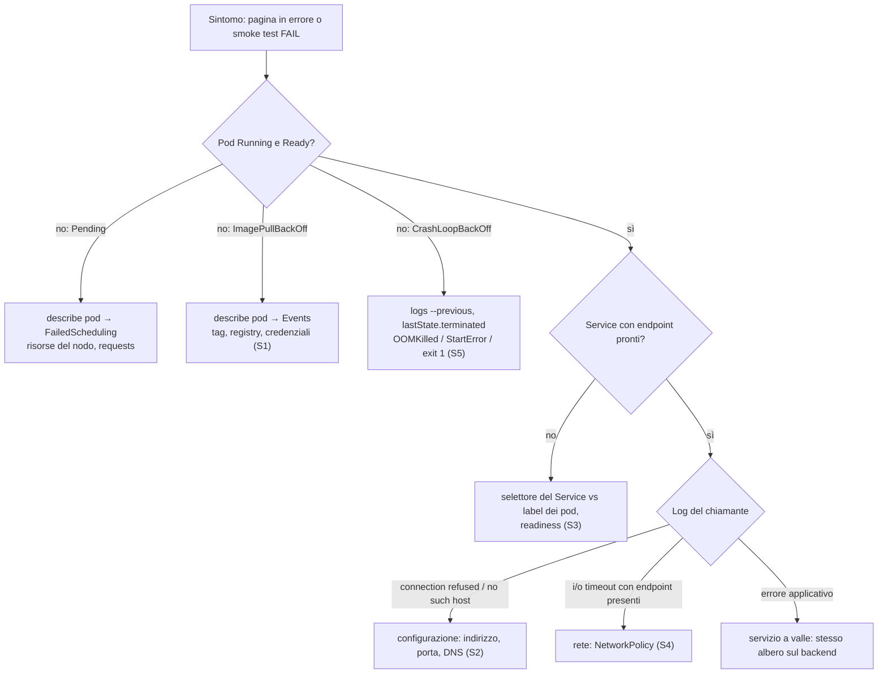

# Runbook operativo: verifica, troubleshooting, rollback

Ambito: Online Boutique su kind (`kind-boutique`), ambienti `dev` e `prod`, consegnati da Argo CD a partire da `main` (R-17, R-18, R-19).
Ogni comando di questo documento, salvo dove è indicato "non eseguito", è stato eseguito almeno una volta su questo cluster (novembre 2026, Kubernetes `v1.37.0`, Argo CD `v3.6.1`);
gli output riportati sono reali e ridotti alle righe utili.

Regole valide per tutto il documento:
- **Prima di ogni comando che modifica**: `kubectl config current-context` → `kind-boutique`.
- **Si diagnostica prima di agire**: nessun riavvio "per vedere se passa" finché le evidenze non sono salvate (i pod ricreati perdono log ed eventi).
- **Git è la fonte di verità**: un rimedio fatto a mano nel cluster è temporaneo; il rimedio definitivo è un commit.


## 1. Verifica dello stato

### 1.1 In un comando

```
scripts/smoke-test.sh dev      # oppure prod
```

Controlla quattro livelli, dal basso verso l'alto; il primo `FAIL` indica dove guardare:

```
Livello;Controllo;FAIL significa
Argo CD;Application Healthy (Synced è solo WARN);risorse non sane o rollout in corso
Workload;ogni Deployment: pronti = desiderati e nessun pod in più;pod non pronti, oppure rollout bloccato (i pod vecchi servono ancora)
Service;ogni Service ha almeno un endpoint pronto;selettore sbagliato o pod non pronti: il traffico non arriva a nessuno
HTTP;/ , /product/OLJCESPC7Z , /cart → 200 dall'Ingress;l'app risponde con errore anche se Kubernetes è "verde"
```

Exit code: `0` tutto PASS, `1` almeno un FAIL, `2` uso sbagliato o contesto diverso da `kind-boutique`.
Subito dopo un rollout aspettare `kubectl rollout status deploy/<nome> -n <env>`: per qualche secondo il pod che termina riceve ancora traffico.

### 1.2 A mano, livello per livello

```
# Argo CD: allineamento a Git e salute
kubectl get applications -n argocd
kubectl get application boutique-dev -n argocd -o json | jq -c '.status.resources[] | select(.status!="Synced" or (.health.status // "Healthy")!="Healthy") | {kind,name,status,health:.health.status}'

# Pod: stato, riavvii, motivo dell'ultimo arresto
kubectl get pods -n dev -o wide
kubectl get pods -n dev -o jsonpath='{range .items[*]}{.metadata.name} {.status.containerStatuses[0].restartCount} {.status.containerStatuses[0].lastState.terminated.reason}{"\n"}{end}'

# Eventi recenti (durano un'ora)
kubectl get events -n dev --sort-by=.lastTimestamp | tail -20

# Service ed endpoint: un Service senza endpoint pronti non porta traffico
kubectl get svc -n dev
kubectl get endpointslices -n dev
kubectl get endpointslices -n dev -l kubernetes.io/service-name=cartservice

# Ingress e risposta HTTP
kubectl get ingress -A
curl -s -o /dev/null -w '%{http_code}\n' http://dev.boutique.localhost/

# Log JSON del frontend: solo gli errori
kubectl logs -n dev deploy/frontend -c server --tail=300 | jq -c 'select(.severity=="error") | {error, path: ."http.req.path"}'

# Metriche: Prometheus interrogato attraverso l'API server (nessun port-forward)
kubectl get --raw '/api/v1/namespaces/monitoring/services/monitoring-kube-prometheus-prometheus:9090/proxy/api/v1/query?query=kube_pod_container_status_waiting_reason%7Bnamespace%3D%22dev%22%7D' | jq -c '.data.result[] | {pod:.metric.pod, reason:.metric.reason}'
```

Nota sugli alert: le regole di kube-prometheus-stack (`KubePodCrashLooping`, `KubePodNotReady`, `KubeDeploymentRolloutStuck`) scattano dopo
`for: 15m` (`KubeContainerWaiting` dopo 1 h). Sono giuste per non svegliare nessuno per un riavvio isolato, ma in diagnosi conviene leggere
direttamente le metriche (`kube_pod_container_status_waiting_reason`, `kube_deployment_status_replicas_unavailable`). Alertmanager non è installato (D-28):
gli alert attivi si vedono in Prometheus → Alerts.


## 2. Metodo

Sintomo → evidenze → ipotesi → causa → rimedio → verifica. Le evidenze si raccolgono **prima** di cambiare qualcosa.



Due trappole viste davvero (sezione 3):
- **Il rolling update nasconde un rilascio rotto**: il pod vecchio resta in servizio, il sito risponde 200, ma il rollout è fermo.
- **Le connessioni già aperte nascondono un guasto di rete**: il frontend usa connessioni gRPC (HTTP/2) di lunga durata; un Service svuotato
  o una NetworkPolicy più stretta bloccano solo le connessioni *nuove*. Il guasto si vede al primo riavvio del client.


## 3. Scenari riprodotti

Gli scenari S1-S4 si riproducono in `dev` con `scripts/fault.sh` (mai in prod):

```
scripts/fault.sh list
scripts/fault.sh <scenario> inject     # sospende la sync automatica di boutique-dev e rompe una risorsa gestita da Argo CD
scripts/smoke-test.sh dev              # FAIL atteso
scripts/fault.sh restore               # riapplica l'Application da Git: sync automatica attiva, Argo CD riporta dev a Git
kubectl rollout status deploy/frontend -n dev && scripts/smoke-test.sh dev
```

La sospensione serve perché `boutique-dev` ha `selfHeal`: una modifica fatta con `kubectl` verrebbe annullata in pochi secondi.

```
Scenario;Guasto;Pod;Endpoint;HTTP;Indizio decisivo;Rimedio
S1 bad-image;tag dell'immagine inesistente;nuovo ImagePullBackOff, vecchio Running;presenti;200 (serve il pod vecchio);evento "not found", rollout non completo;correggere il tag in Git
S2 bad-config;indirizzo del catalogo sbagliato;Running e Ready;presenti;500;log "could not retrieve product";correggere la variabile in Git
S3 no-endpoints;selettore del Service sbagliato;Running e Ready;vuoti;500 alle connessioni nuove;EndpointSlice vuoto;allineare selettore e label in Git
S4 netpol;NetworkPolicy senza il permesso dal frontend;Running e Ready;presenti;500 alle connessioni nuove;i/o timeout con endpoint presenti;ripristinare la policy da Git
S5 rilascio cattivo;memoria request/limit 4Mi invece di 64Mi/128Mi (commit su main);nuovo CrashLoopBackOff, vecchio Running;presenti;200 (serve il pod vecchio);evento "container init was OOM-killed";git revert (sezione 4)
```

### S1 — Immagine inesistente (`ImagePullBackOff`)
- **Sintomo**: smoke test `FAIL argocd … health=Progressing` e `FAIL deploy frontend rollout not complete: 2 pods for 1 replicas`; il sito risponde 200.
- **Evidenze**:
  ```
  $ kubectl get pods -n dev -l app=frontend
  frontend-5b8c4f96b9-q4dcr   0/1     ImagePullBackOff   0               2m5s
  frontend-645647db89-bvmqh   1/1     Running            1 (5h18m ago)   5h49m
  $ kubectl describe pod -n dev frontend-5b8c4f96b9-q4dcr | sed -n '/^Events:/,$p'
  Warning  Failed  … Failed to pull image "ghcr.io/gverro/microservices-demo/frontend:v0.0.0-does-not-exist": … not found
  ```
  Prometheus: `kube_pod_container_status_waiting_reason{namespace="dev"}` → `ImagePullBackOff` = 1.
- **Causa**: il tag non esiste nel registry. Il rolling update (`maxSurge` 25% → un pod in più, `maxUnavailable` 25% → zero pod tolti con una replica)
  tiene in servizio il pod vecchio, quindi gli utenti non vedono nulla.
- **Rimedio e verifica**: tag corretto in Git (o `restore`) → Synced/Healthy in 5 s; resta il pod vecchio, perché il ReplicaSet precedente ha lo stesso template.
- Nota: in questo repository un tag nuovo in `values-common.yaml` viene **pubblicato** dalla CI al merge (D-22); il caso reale è un tag scritto male in un ambiente
  o un registry irraggiungibile.

### S2 — Configurazione sbagliata (pod Ready, pagine 500)
- **Sintomo**: `FAIL http GET …/product/OLJCESPC7Z -> 500`; pod `1/1 Running`, endpoint presenti.
- **Evidenze**:
  ```
  $ kubectl logs -n dev deploy/frontend -c server --tail=300 | jq -c 'select(.severity=="error") | {error, path: ."http.req.path"}'
  {"error":"could not retrieve product: rpc error: code = Unavailable desc = connection error: … dial tcp 127.0.0.1:3550: connect: connection refused","path":"/product/1YMWWN1N4O"}
  $ kubectl get deploy frontend -n dev -o jsonpath='{range .spec.template.spec.containers[0].env[?(@.name=="PRODUCT_CATALOG_SERVICE_ADDR")]}{.name}={.value}{end}'
  PRODUCT_CATALOG_SERVICE_ADDR=productcatalog:3550
  $ kubectl get svc -n dev productcatalog
  Error from server (NotFound): services "productcatalog" not found
  ```
- **Causa**: il nome del Service è `productcatalogservice`. Il pod resta Ready perché la `/_healthz` del frontend non controlla i backend (scelta corretta:
  una readiness che dipende dai backend toglierebbe dal traffico tutti i frontend per un guasto a valle), e il client gRPC si connette solo alla prima chiamata.
- **Attenzione, il messaggio può ingannare**: con `ndots:5` un nome corto non trovato nel cluster viene cercato anche nei domini di ricerca ereditati dalla rete
  dell'host. Su questa macchina il DNS della rete locale risponde `127.0.0.1`, quindi l'errore è `connection refused` invece di "host non trovato";
  su un'altra rete lo stesso guasto dà NXDOMAIN. L'immagine del frontend è distroless: per vedere il DNS dal pod si usa un container effimero:
  ```
  kubectl debug -n dev <pod-frontend> --image=busybox:1.37.0 --profile=restricted -c dbg --attach=false -- sleep 600
  kubectl exec -n dev <pod-frontend> -c dbg -- cat /etc/resolv.conf
  kubectl exec -n dev <pod-frontend> -c dbg -- nslookup -type=a productcatalog
  ```
- **Rimedio e verifica**: variabile corretta in Git (o `restore`) → Synced/Healthy in 18 s, smoke test OK.

### S3 — Service senza endpoint
- **Sintomo**: `FAIL service cartservice has no ready endpoints`; all'inizio le pagine rispondono ancora 200.
- **Evidenze**:
  ```
  $ kubectl get pods -n dev -l app=cartservice
  cartservice-77b59b997f-52bpc   1/1     Running   1 (5h20m ago)   6h40m
  $ kubectl get svc cartservice -n dev -o wide
  cartservice   ClusterIP   10.96.169.165   <none>   7070/TCP   6h40m   app=cart-service
  $ kubectl get endpointslices -n dev -l kubernetes.io/service-name=cartservice
  cartservice-ct656   IPv4   <unset>   <unset>   6h40m
  ```
  Dopo il riavvio del frontend (connessioni nuove): `/` → 500 in 19,6 s, poi 500 subito; log
  `could not retrieve cart: … dial tcp 10.96.169.165:7070: i/o timeout`.
- **Causa**: il selettore del Service (`app=cart-service`) non corrisponde alla label dei pod (`app=cartservice`). Le connessioni gRPC già aperte
  hanno continuato a funzionare finché il frontend non si è riavviato.
- **Rimedio e verifica**: selettore da Git (o `restore`) → endpoint `10.244.0.12`, smoke test OK.

### S4 — NetworkPolicy che blocca
- **Sintomo**: dopo un riavvio del frontend `/product/…` → 500 (la prima richiesta dopo 20,6 s); pod ed endpoint presenti.
- **Evidenze**:
  ```
  $ kubectl get endpointslices -n dev -l kubernetes.io/service-name=productcatalogservice --no-headers
  productcatalogservice-2gn69   IPv4   3550   10.244.0.37   6h54m
  $ kubectl logs … | jq …
  {"error":"could not retrieve product: … dial tcp 10.96.151.255:3550: i/o timeout","path":"/product/OLJCESPC7Z"}
  $ kubectl get networkpolicy productcatalogservice -n dev -o jsonpath='{.spec.ingress[0].from}'
  [{"podSelector":{"matchLabels":{"app":"checkoutservice"}}},{"podSelector":{"matchLabels":{"app":"recommendationservice"}}}]
  ```
- **Causa**: nel namespace c'è `deny-all` e ogni servizio ha la sua policy di permesso; a quella di `productcatalogservice` è stato tolto `app=frontend`.
  Le NetworkPolicy si **sommano** (ognuna aggiunge permessi): un blocco nasce sempre da un permesso mancante, non da una policy "di divieto" in più.
- **Differenza con S3**: stesso `i/o timeout`, ma qui gli endpoint ci sono → il problema è la rete, non il Service.
- **Rimedio e verifica**: policy da Git (o `restore`) → smoke test OK.

### S5 — Rilascio cattivo arrivato da Git (`CrashLoopBackOff`)
- **Guasto**: commit su `main` (PR #10) con memoria del frontend `4Mi` invece di `64Mi`, solo in `values-dev.yaml`. Supera `helm lint` e kubeconform:
  la CI è verde. È il caso che la validazione non può fermare.
- **Sintomo**: smoke test `FAIL argocd … health=Progressing` e `FAIL deploy frontend rollout not complete: 2 pods for 1 replicas`; il sito risponde 200.
- **Evidenze**:
  ```
  $ kubectl get pods -n dev -l app=frontend
  frontend-84cb6c67d-d4g7b   1/1     Running            0            10h
  frontend-9fc489bf5-cljsq   0/1     CrashLoopBackOff   1 (7s ago)   17s
  $ kubectl get events -n dev --field-selector involvedObject.name=frontend-9fc489bf5-cljsq,reason=Failed -o jsonpath='{.items[-1].message}'
  Error: … runc create failed: unable to start container process: container init was OOM-killed (memory limit too low?)
  ```
  Lo stato alterna `RunContainerError` e `CrashLoopBackOff` con attese crescenti. Dopo 10 minuti (`progressDeadlineSeconds: 600`) Argo CD passa
  da `Progressing` a **`Degraded`**: terzo segnale del rollout bloccato, oltre a eventi e smoke test.
- **Causa**: il limite di memoria è più basso di quello che serve per avviare il container (qui muore il processo di init di runc, exit 128 `StartError`;
  con un limite poco più alto si vedrebbe `OOMKilled`, exit 137, a regime). Il rolling update tiene in servizio il pod vecchio.
- **Rimedio**: `git revert` (sezione 4.2). Non `kubectl rollout undo` (sezione 4.4).


## 4. Rollback

### 4.1 Quale strumento, quando

```
Metodo;Dove;Quando;Effetto su Git;Note
git revert + merge;dev e prod;sempre, è il rollback normale;Git torna allo stato buono;dev si aggiorna da solo; prod dopo la promozione (sync manuale)
Argo CD History and Rollback;solo prod (sync manuale);emergenza, quando il revert richiede troppo tempo;nessuno: prod diverge da main (OutOfSync);vietato con la sync automatica; dopo va fatto comunque il revert
kubectl rollout undo;nessuno;mai sotto GitOps;nessuno;in dev selfHeal lo annulla; in prod crea drift
helm rollback;solo piattaforma (traefik, argocd, monitoring, sealed-secrets);dopo un upgrade di piattaforma andato male;nessuno (install.sh e i values vanno corretti);l'app non è una release Helm: Argo CD usa helm template
```

Il limite della history di Argo CD è nel codice di Argo CD v3.6.1 (`server/application/application.go`, funzione `Rollback`):
`rollback cannot be initiated when auto-sync is enabled`; per le Application multi-source come le nostre la sync usa le `sources` e le `revisions`
salvate nella voce di history ("Rollback is just a convenience around Sync").

### 4.2 Rollback in dev con `git revert` (eseguito)

```
git switch main && git pull
git log --oneline --no-merges -3 -- deploy/values-dev.yaml   # il commit cattivo, non il merge della PR
git switch -c fix/revert-<sha>
git revert <sha>                                 # nuovo commit che annulla il precedente
git push -u origin fix/revert-<sha>               # PR (gh pr create --repo gverro/microservices-demo), CI verde, merge
kubectl get application boutique-dev -n argocd -w # Argo CD applica il revert come qualsiasi commit
scripts/smoke-test.sh dev
```

Esito (17/11/2026, ore UTC): rilascio cattivo PR #10, revert PR #11.

```
Momento;Ora;Note
merge della PR #10 (4Mi);09:41:16;
Argo CD vede il commit;09:45:16;polling ogni ~3 min
pod nuovo in CrashLoopBackOff;09:46:31;pod vecchio Running, HTTP 200
Argo CD Degraded;09:56:17;progressDeadlineSeconds 600
merge della PR #11 (git revert);10:03:24;
Argo CD vede il commit;10:06:31;3 min 7 s di attesa
sync completata;10:06:37;initiatedBy automated
Synced/Healthy, pod rotto rimosso;10:06:39;3 min 15 s dal merge del revert
```

Durante tutto l'incidente (09:41 → 10:06) il sito ha risposto 200: il pod vecchio (`84cb6c67d-d4g7b`) non è mai stato tolto ed è lo stesso dopo il rollback.
Il revert produce esattamente lo stato precedente (`git diff <commit buono> HEAD` vuoto). Il tempo è quasi tutto attesa del polling di Argo CD:
un webhook da GitHub lo eliminerebbe, ma un cluster kind locale non è raggiungibile da GitHub.

### 4.3 Rollback di emergenza in prod dalla history di Argo CD

Procedura (UI, http://argocd.localhost): `boutique-prod` → **History and rollback** → riga della voce buona → menu ⋮ → **Rollback** → conferma.
Poi, sempre: `git revert` del commit che ha causato il problema, così `main` torna a coincidere con prod.

```
# prima: quali voci ci sono e quale revisione contengono
kubectl get application boutique-prod -n argocd -o json | jq -c '.status.history[] | {id, rev:.revisions[0][0:8], deployedAt, by:.initiatedBy.username}'
# dopo: operazione eseguita e stato
kubectl get application boutique-prod -n argocd -o json | jq -c '{sync:.status.sync.status, health:.status.health.status, op:.status.operationState.phase, revs:.status.operationState.syncResult.revisions}'
```

Attenzione: la history riporta alla revisione **salvata in quella voce**, non all'ultimo `main` buono. Prima di scegliere la voce si guarda cosa contiene.

Esito (17/11/2026, ore UTC): modifica innocua e visibile in prod (banner "Local", PR #12), poi rollback dalla history e revert in Git (PR #13).

```
Momento;Ora;Note
merge della PR #12;10:13:26;prod OutOfSync, nessuna sync da sola
promozione (sync manuale, admin);10:14:13;history id 1; rolling update dei 2 frontend
rollback dalla history a id 0 (admin);10:14:51 → 10:14:55;history id 2, revisione 74fee661
prod Healthy, banner On-Premises;10:15:29;stato OutOfSync/Healthy: prod gira la versione vecchia, main dice ancora "Local"
merge della PR #13 (git revert);10:52:41;
prod Synced;10:52:57;nessuna nuova sync né rollout: Git e cluster coincidono di nuovo
```

Durante entrambi i rolling update il banner alternava le due versioni (una per pod) per circa 20 s: una modifica deve poter convivere con la versione precedente.
Dopo il rollback lo smoke test di prod è OK con `WARN sync=OutOfSync`, che sparisce con il revert.

### 4.4 Perché non `kubectl rollout undo`

Prova in dev con il rilascio cattivo ancora in `main` (17/11):

```
$ kubectl rollout undo deploy/frontend -n dev            # 10:00:37
Warning: … Rolling back will not update the kubectl.kubernetes.io/last-applied-configuration annotation …
deployment.apps/frontend rolled back                     # limit di memoria di nuovo 128Mi
$ kubectl get application boutique-dev -n argocd -o jsonpath='{.status.operationState.operation.initiatedBy} {.status.operationState.startedAt}'
{"automated":true} 2026-11-17T10:00:45Z                  # 8 s dopo: selfHeal rimette 4Mi, il pod rotto torna
```

In dev il rimedio dura 8 secondi: Git dice ancora 4Mi. In prod (senza sync automatica) resterebbe, ma come drift: cluster diverso da Git,
nessuna traccia nella history di Argo CD e il prossimo sync lo cancella. Il rollback che tiene è quello in Git.

### 4.5 Piattaforma: `helm rollback`

Le componenti di piattaforma sono release Helm installate da `scripts/install.sh` (D-27):

```
$ helm list -A
argocd          argocd       3  deployed  argo-cd-10.18.0
monitoring      monitoring   3  deployed  kube-prometheus-stack-93.3.0
sealed-secrets  kube-system  3  deployed  sealed-secrets-2.22.0
traefik         traefik      3  deployed  traefik-42.3.2
```

```
helm history traefik -n traefik            # revisioni e loro stato
helm rollback traefik <revisione> -n traefik --wait
```

Non eseguito su questo cluster (nessun upgrade di piattaforma da annullare). Dopo un `helm rollback` va corretto anche il values in `deploy/platform/`,
altrimenti il prossimo `install.sh` riapplica la versione rotta.


## 5. Casi reali (non provocati)

```
Caso;Sintomo;Causa;Rimedio;Riferimento
Liveness all'avvio a freddo;dopo il riavvio del PC pod Python e Redis con exit 137 e restart;24 pod che partono insieme, CPU contesa, liveness con timeout 1 s;startupProbe e timeout 3 s (probes.tuning);D-29, CHANGES
Grafana in thrashing;grafana.localhost → 503, nodo al 615% di CPU;limite di memoria 384Mi: la page cache conta nel cgroup, Grafana rileggeva i file di continuo (~1 TB in 1 h);limite 1Gi;deploy/platform/monitoring-values.yaml
Componenti di piattaforma uccisi dalla liveness al boot;restart di argocd-server, operator, kube-state-metrics;stesso problema di CPU all'avvio;liveness tolleranti nei values di piattaforma;D-29
DNS che risponde 127.0.0.1;nome di Service sbagliato → connection refused invece di NXDOMAIN;domini di ricerca dell'host ereditati dal pod + DNS locale;nessuno sul cluster: sapere che il messaggio dipende dalla rete;S2
```

Lezione comune: quando gli eventi sono scaduti (durano un'ora), il guasto si **riproduce** in modo controllato invece di indovinare
(es. `docker restart boutique-control-plane` per l'avvio a freddo).


## 6. Escalation

Si passa il problema al livello successivo (sviluppo dell'app, owner della piattaforma) quando la causa è nel codice o fuori dal cluster, oppure
quando il rimedio richiede una modifica che non si può validare (CI) entro il tempo concordato. Prima di passarlo:

1. **Mitigare** se possibile senza perdere evidenze: rollback (sezione 4), che in GitOps è reversibile e tracciato.
2. **Consegnare le evidenze**, non le impressioni:
   ```
   kubectl get pods,svc,endpointslices,ingress -n <env> -o wide            > state.txt
   kubectl get events -n <env> --sort-by=.lastTimestamp                     > events.txt
   kubectl logs -n <env> deploy/<servizio> --all-containers --tail=500      > logs.txt
   kubectl logs -n <env> <pod> --previous                                   > logs-previous.txt   # se il container è ripartito
   kubectl get application boutique-<env> -n argocd -o yaml                 > argocd.txt
   scripts/smoke-test.sh <env>                                              > smoke.txt
   ```
3. Scrivere in 5 righe: sintomo e ora d'inizio, impatto (quale ambiente, quali pagine), cosa è stato escluso e come, ipotesi corrente, rimedio già tentato.
4. Nessun secret nei file consegnati: i log dell'app non contengono password (Redis le riceve da `secretKeyRef`), ma vanno ricontrollati prima di inoltrarli.
